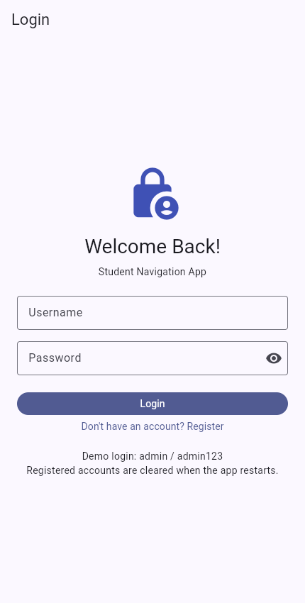
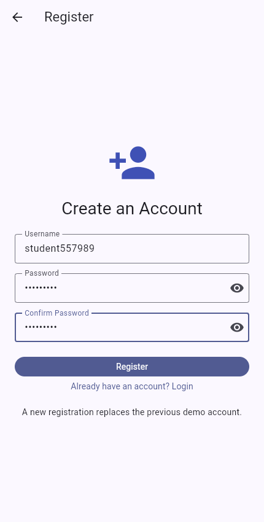
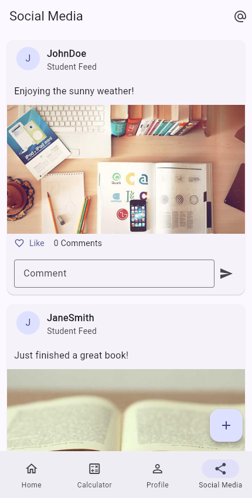
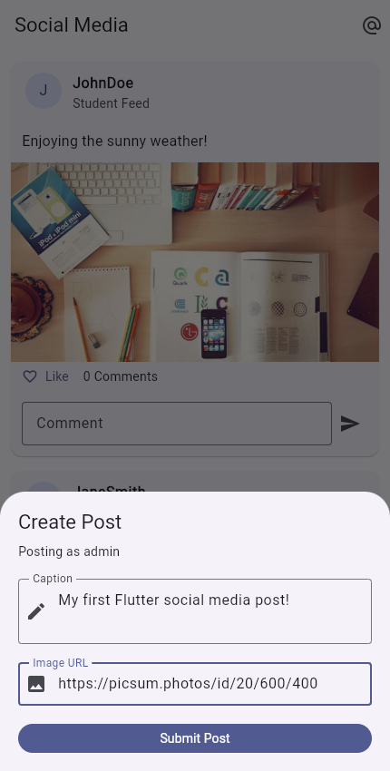
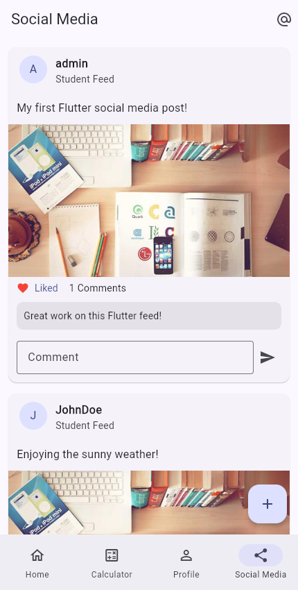

# Social Media Feed Activity

Jolex Pasignasigna | 557989 | BSIT, 3rd Year | CCE106(3450)

Repository: https://github.com/saltylex/Room5activity

Google Docs: https://docs.google.com/document/d/1URl4_WeobLk4QxG9OzEba9X8KN3pZBMm9D6yqQxTZMU/edit?usp=drivesdk

## Testing table

| Test | Actual output | Result |
| --- | --- | --- |
| Log in with admin / admin123 | MainScreen opens; currentUsername is admin. | Pass |
| Open Social Media | JohnDoe and JaneSmith sample posts appear. | Pass |
| Submit empty post fields | Submission stops and a completion message appears. | Pass |
| Submit an invalid image URL | Only HTTP/HTTPS URLs with a host are accepted. | Pass |
| Submit a valid post | New post is first and uses the logged-in username. | Pass |
| Tap Like twice | Like changes to Liked, then returns to Like. | Pass |
| Send a nonempty comment | Trimmed comment appears; count increases; field clears. | Pass |
| Send a blank comment | No comment is added; count stays unchanged. | Pass |
| Like a sample, then insert new posts | Original post keeps its like, comments and draft. | Pass |
| Switch Home and back to Social Media | Posts, likes, comments and scroll state remain. | Pass |
| Log out, register and log in | Session clears; Back cannot reopen MainScreen; new posts use the registered username. | Pass |

## Code tracing

| Action | Statement | What happens |
| --- | --- | --- |
| Successful login | DemoAuth.login() | Checks admin or the registered account, stores currentUsername and returns true; Login replaces itself with MainScreen. |
| Tap the + button | openCreatePostSheet() | Opens a scrollable modal and passes the current username. Await waits for a Post or a cancelled/null result. |
| Submit a valid post | Navigator.pop(context, newPost) | Closes the sheet and returns the validated Post to the awaiting feed. |
| Receive the new post | posts.insert(0, newPost) | Adds the post first inside setState and scrolls the feed to the top. Stable keys retain existing card state. |
| Tap Like | isLiked = !isLiked | Toggles the card's Boolean reaction state and rebuilds its heart icon and label. |
| Send a comment | comments.add(comment) | Adds a trimmed, nonempty comment inside setState, increases the displayed count and clears the input. |

## Screenshots

### Login

The application starts at Login. The built-in account is admin / admin123. A successful login stores the username and replaces the login route with MainScreen.

### Registration

Username, password and confirmation validation remain in place. This screenshot uses the demo username student557989. Registration returns to Login, where both the registered account and default admin account can be used.

### Social Media feed

The Social Media destination displays the two starter posts. Each card has a caption, image, Like button, comment count and comment entry. The app-bar action keeps the student's personal social links accessible.

### Create Post form

The modal uses the logged-in username admin. The caption and image URL are required. The scroll view, safe area and keyboard padding keep the form accessible on smaller screens.

### Post with a like and comment

The new post appears first with username admin, the Liked state and a visible comment. Automated tests also verify unlike, blank comments, insertion without losing old interactions, tab switching, logout and posting as a registered user.

## Limits

[Download the PDF report](Pasignasigna_Social_Feed.pdf).

## Verification

- Dart formatting: passed, 18 files unchanged.
- Flutter analysis: passed, no issues.
- Automated tests: all 12 passed (authentication, existing features and feed).
- Web build and Android debug APK build: passed.
- Microsoft Edge browser flow: admin and registered login, posting validation,
  post author/order, like/unlike, commenting, tab retention and logout passed.
- Native Google Doc: verified five inline screenshots and two real tables
  (12 rows for testing, 7 rows for tracing, including headers).
- PDF: eight pages, five screenshots, table placement and layout checked.
- Widget HTTP requests intentionally fail to exercise the image placeholder;
  real image loading was verified in Edge. Physical mobile and macOS/iOS
  behavior still need manual testing.

## Storage and submission limits

Feed data is kept in memory. A full restart clears accounts and posts; logout
clears the session and discards the feed. Network images need internet; unsupported
or blocked images show a placeholder. The prior navigation report is preserved.
The PDF is prepared for upload to Blackboard; Blackboard submission is manual.
